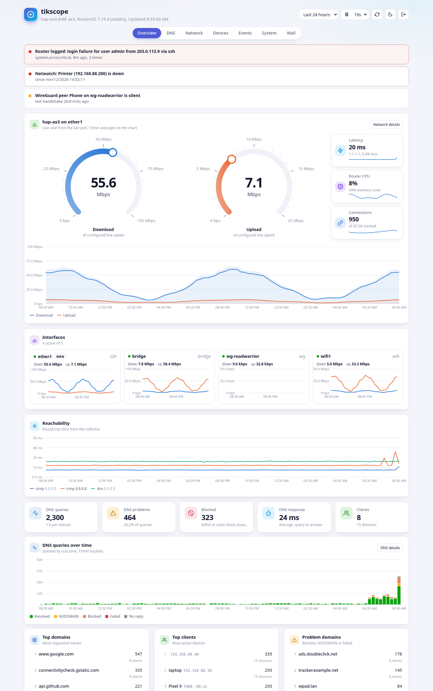
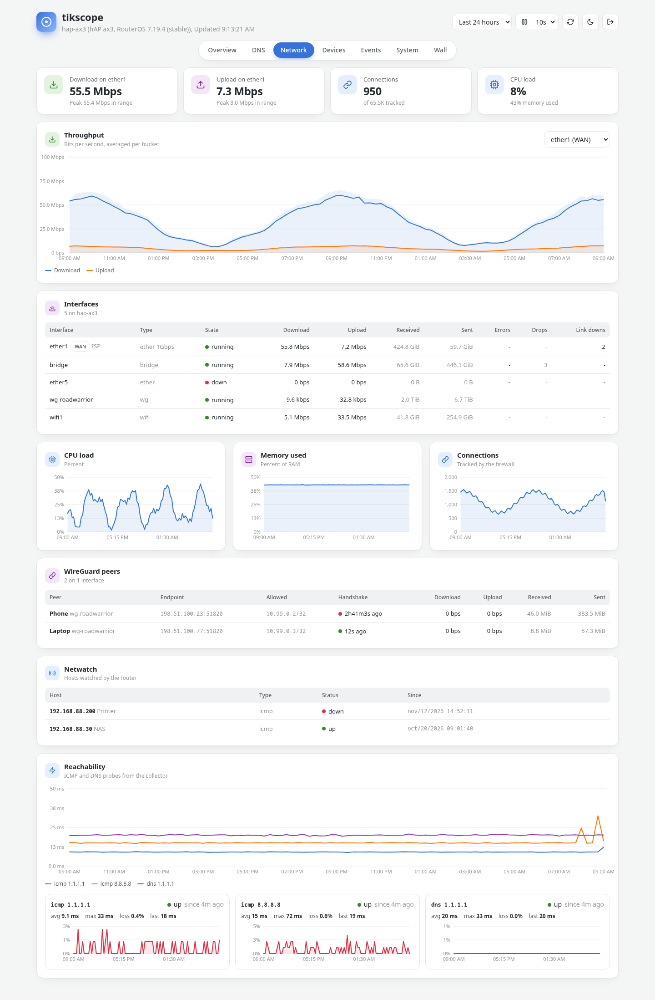
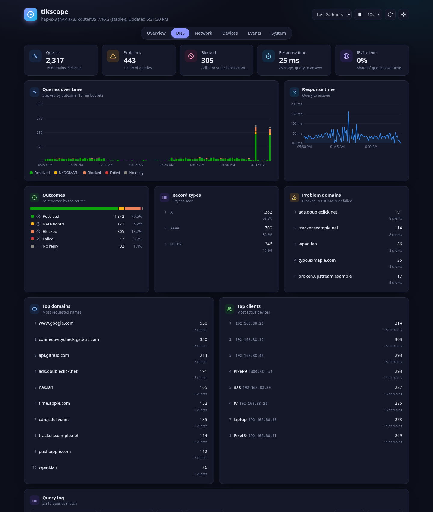
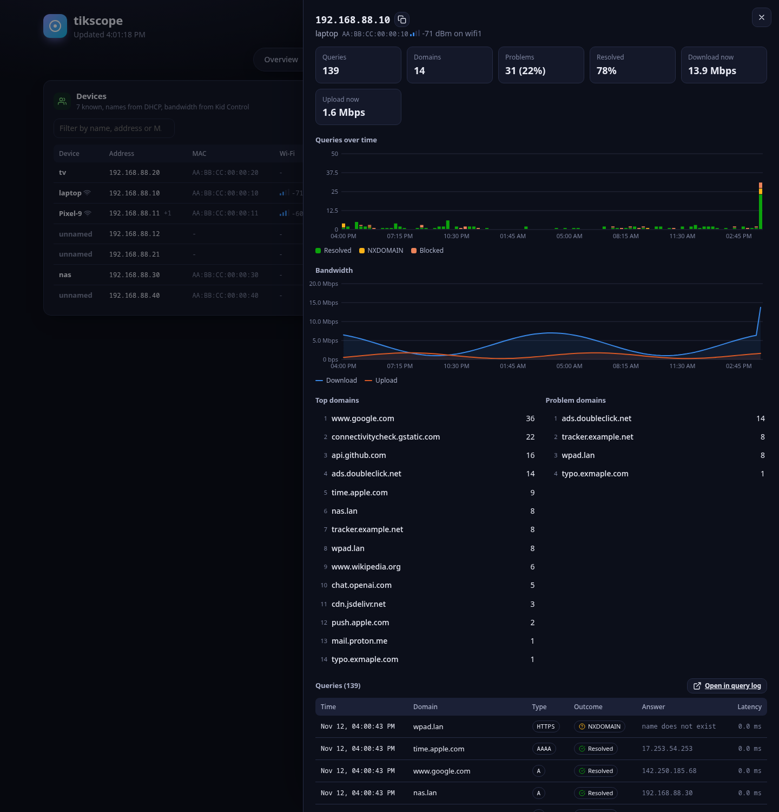
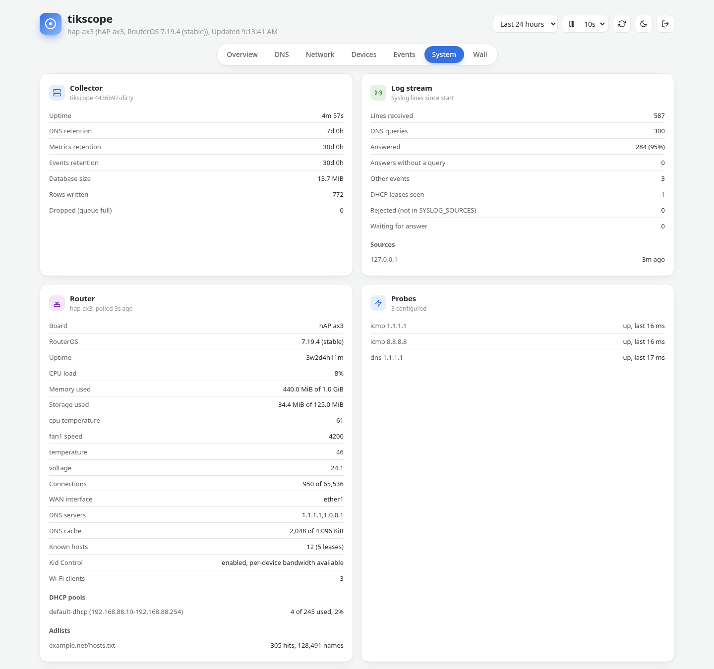
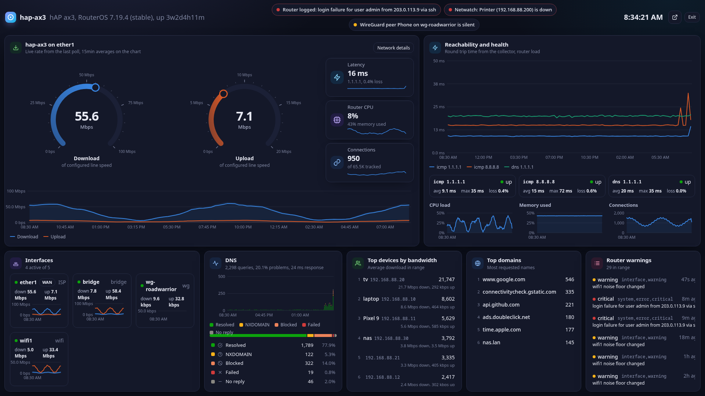
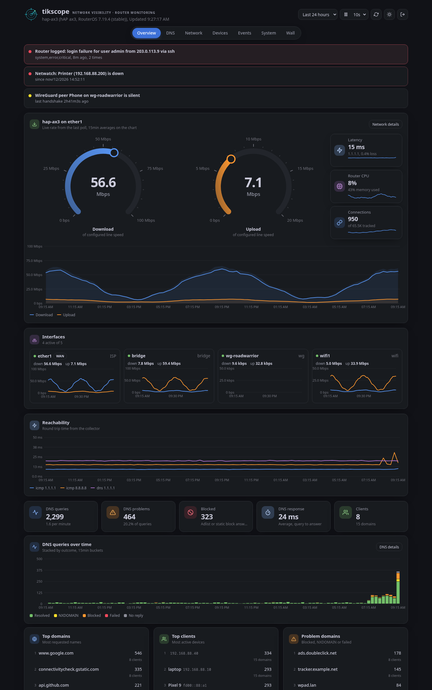

<p align="center">
  <picture>
    <source media="(prefers-color-scheme: dark)" srcset="docs/logo.png" width="220">
    
  </picture>
</p>

# tikscope

**Network visibility &middot; Router monitoring.**

I have plenty of dashboards in my homelab already. Grafana, a couple of
MikroTik ones, a status page for every service. What I never had was one
place that shows me everything my router knows. How fast is the line right
now? Which device is eating the bandwidth? What did the router resolve, and
for whom? Is anything broken? I had wanted a tool like that for a long time,
so I built it.

tikscope is a single Go binary with a SQLite file next to it. It reads the
router's own log stream and REST API, and that is all it needs. You get DNS
analytics, throughput and health, reachability checks from the collector,
and a list of what is wrong right now, all on one page.

## What it shows

- **Issues**: things that need attention. Packet loss or latency spikes to
  the probe targets, DNS failures, slow or missing DNS answers, link flaps
  and interface errors, high CPU, memory or connection table usage, WAN
  down, Netwatch hosts down, silent WireGuard peers, DHCP pools running out,
  errors in the router log, and a log stream that went quiet.
- **DNS**: every query the router handled, with the client, domain, record
  type, outcome (`ok`, `nodata`, `nxdomain`, `servfail`, `blocked`,
  `error`), the answer and how long it took. This comes from the RouterOS 7
  `dns query` and `dns done query` log lines. You get timelines, breakdowns
  by outcome and type, top and problem domains, top clients, a searchable
  query log with CSV export, and drill-downs per client and per domain with
  a "resolve now" button.
- **Network**: download and upload speedometers, a graph per interface, an
  interface table with link rate, errors, drops and link downs, CPU, memory
  and connection history, WireGuard peers, Netwatch hosts, and ICMP and DNS
  probe latency and loss.
- **Devices**: every client the router knows about, with name and MAC (from
  DHCP log lines, leases, ARP and IPv6 neighbours), its DNS activity, its
  bandwidth via Kid Control and its Wi-Fi signal.
- **Events**: the router log, with severity, search and paging.
- **System**: collector counters, router identity, version, uptime, health
  sensors, DHCP pool usage, DNS cache, adlists and probe state.

Pick any time range from 1 hour to 30 days, or drag across a chart to zoom
into that span. Every page follows, the window is in the URL so a link or a
reload keeps it, the arrows next to the range (or the arrow keys) pan it, and
a double click or the x takes you back. "vs yesterday" or "vs last week" draws
the same window from an earlier period as a dashed line on the throughput and
DNS charts. The light and dark themes use Grafana's colors. Charts scale to
their own peak, and the speedometers use your line speed if you set it, or the
peak in range if you don't, and hold the last peak for five minutes. Refreshes
don't flicker and wait while you hover a chart. The browser's back button
closes a detail panel. It works on a phone, and the wall mode (`#wall`) fits
any screen without scrolling.

## Screenshots

Overview: issues, WAN speedometers, interfaces, reachability, DNS.



Network: throughput with peak bands, interfaces, CPU, memory, connections,
WireGuard, Netwatch, probes.



DNS analytics and a device drill-down.





System: collector counters, log stream, router snapshot, probes.



Wall mode for a TV or a spare monitor. Clock, issue strip, fullscreen
button, and it scales up on big displays.



Dark theme:



## Setup

Four steps: run the collector, point the router's log at it, create a
read-only API user, check that it works. Replace `192.168.88.1` (the
router), `192.168.88.50` (the collector) and the subnet with your own.

### 1. Run the collector

Docker Compose:

```bash
git clone https://github.com/aganet/tikscope.git
cd tikscope
cp .env.example .env      # edit MIKROTIK_* and PROBE_* values
docker compose up -d --build
```

Plain Docker, no clone:

```bash
docker build -t tikscope https://github.com/aganet/tikscope.git
docker run -d --name tikscope --restart unless-stopped \
  -p 3000:3000 -p 5354:5354/udp -v $(pwd)/data:/data \
  -e MIKROTIK_URL=https://192.168.88.1 -e MIKROTIK_USER=tikscope \
  -e MIKROTIK_PASSWORD=change-me -e MIKROTIK_INSECURE=true \
  -e PROBE_DNS=192.168.88.1 -e POLL_INTERVAL=1s \
  tikscope
```

Binary, no Docker (Go 1.26+):

```bash
make build
set -a; . ./.env; set +a
./tikscope
```

The dashboard is on <http://localhost:3000>, syslog listens on UDP 5354,
and the data lives in `./data`.

### 2. Send the router log to the collector

Terminal:

```text
/system logging action add name=tikscope target=remote remote=192.168.88.50 remote-port=5354
/system logging add topics=dns action=tikscope
/system logging add topics=info,!dns action=tikscope
/system logging add topics=warning action=tikscope
/system logging add topics=error action=tikscope
/system logging add topics=critical action=tikscope
```

Winbox / WebFig:

1. **System > Logging**, tab **Actions**, **+**: Name `tikscope`, Type `remote`, Remote Address `192.168.88.50`, Remote Port `5354`, OK.
2. Tab **Rules**, **+**: Topics `dns`, Action `tikscope`, OK.
3. Repeat for `info` (add a second topic `!dns` with the `-` toggle), `warning`, `error`, `critical`.

Leave the `packet` sub-topic out. The default, BSD syslog and ISO timestamp
formats all work.

### 3. Create the read-only API user

This is what gives you throughput, the speedometers, health, connections,
device names, Kid Control bandwidth, Wi-Fi, WireGuard, Netwatch and pools.
Skip it and you still get DNS, events and probes.

Terminal:

```text
# HTTPS service with a self-signed certificate (skip the certificate lines if www-ssl already has one)
/certificate add name=router-ca common-name=router-ca key-usage=key-cert-sign,crl-sign days-valid=3650
/certificate sign router-ca
/certificate add name=router-ssl common-name=router.lan key-usage=digital-signature,key-encipherment,tls-server days-valid=3650
/certificate sign router-ssl ca=router-ca
/ip service set www-ssl disabled=no certificate=router-ssl
/ip firewall filter add chain=input protocol=tcp dst-port=443 src-address=192.168.88.0/24 action=accept comment="tikscope API" place-before=0

# read-only group and user; api is required because REST logs in through the API
/user group add name=tikscope policy=read,api,rest-api,test,!local,!telnet,!ssh,!ftp,!reboot,!write,!policy,!winbox,!password,!web,!sniff,!sensitive,!romon
/user add name=tikscope group=tikscope password=change-me address=192.168.88.50/32

# optional: per device bandwidth
/ip kid-control device add name=all mac-address=00:00:00:00:00:00 dynamic=yes
```

Each `certificate sign` prints `progress: done`. Wait for it.

Winbox / WebFig:

1. **System > Certificates**, **+**: Name `router-ca`, Common Name `router-ca`, tab **Key Usage**: tick only `crl sign` and `key cert. sign`, **Apply**, **Sign**, **Start**, wait for "done", **Close**.
2. **+** again: Name `router-ssl`, Common Name `router.lan`, Key Usage: tick only `digital signature`, `key encipherment`, `tls server`, **Apply**, **Sign**, CA `router-ca`, **Start**, wait, **Close**.
3. **IP > Services**, double-click **www-ssl**: untick Disabled, Certificate `router-ssl`, OK.
4. **IP > Firewall**, tab **Filter Rules**, **+**: Chain `input`, Protocol `tcp`, Dst. Port `443`, Src. Address `192.168.88.0/24`, tab **Action** `accept`, OK, drag the rule to the top.
5. **System > Users**, tab **Groups**, **+**: Name `tikscope`, tick only **read**, **api**, **rest-api**, **test**, OK.
6. Tab **Users**, **+**: Name `tikscope`, Group `tikscope`, Allowed Address `192.168.88.50/32`, Password, OK.
7. Optional, per device bandwidth: **IP > Kid Control**, tab **Devices**, **+**: Name `all`, MAC Address `00:00:00:00:00:00`, tick **Dynamic**, OK.

### 4. Check that it works

From the collector host:

```bash
curl -k -u tikscope:change-me https://192.168.88.1/rest/system/identity
```

You should see `{"name":"..."}`. If you get `401`, the password is wrong,
the user lacks `rest-api`, or its allowed address does not match. `500 not
allowed` means the group is missing `api`. A TLS handshake error means
`www-ssl` has no certificate.

Now open the dashboard. The first visit asks you to create the account: pick
a username and a password of at least 12 characters, and paste the setup
token from the collector log:

```bash
docker compose logs tikscope | grep setup_token
```

After that the header shows the router name within about 15 seconds, the
System tab shows the collector counters and the router snapshot, and the DNS
tab fills up as soon as the first query line arrives.

Forgot the password? Set a new one from the server. This works while the
collector is running and signs that user out everywhere:

```bash
echo -n 'a new long passphrase' | docker compose exec -T tikscope tikscope set-password admin
```

## Configuration

Everything is an environment variable. With Compose, the whole `.env` file
is passed through.

| Variable | Default | Description |
| --- | --- | --- |
| `HTTP_ADDR` | `:3000` | Dashboard and API listen address |
| `SYSLOG_ADDR` | `:5354` | UDP syslog listen address |
| `SYSLOG_SOURCES` | any | Comma separated addresses or CIDRs allowed to send syslog, e.g. `192.168.88.1` |
| `SETUP_TOKEN` | random, printed in the log | Token the account creation page asks for while no account exists |
| `DATABASE_PATH` | `./data/tikscope.db` (`/data/tikscope.db` in Docker) | SQLite file |
| `RETENTION` | `7d` | How long DNS queries are kept |
| `METRICS_RETENTION` | `30d` | How long samples are kept |
| `EVENTS_RETENTION` | `30d` | How long router log events are kept |
| `MIKROTIK_URL`, `MIKROTIK_USER`, `MIKROTIK_PASSWORD` | unset | RouterOS REST API |
| `MIKROTIK_INSECURE` | `false` | Skip TLS certificate verification |
| `POLL_INTERVAL` | `5s` | Fast poll: interfaces, CPU, memory, connections (1s minimum) |
| `POLL_SLOW_INTERVAL` | `1m` | Slow poll: leases, ARP, Wi-Fi, WireGuard, Netwatch, pools, link rates |
| `METRIC_INTERVAL` | `15s` | How often fast metrics are written to the database |
| `WAN_INTERFACE` | auto (default route) | Interface featured on the overview |
| `WAN_DOWN_MBPS`, `WAN_UP_MBPS` | auto (peak in range) | Line speed used as the speedometer scale |
| `PROBE_ICMP` | `1.1.1.1,8.8.8.8` | ICMP targets, comma separated, `none` to disable |
| `PROBE_DNS` | `DNS_SERVER`, else the router | Resolvers to query, comma separated |
| `PROBE_DNS_NAME` | `example.com` | Name resolved by the DNS probes |
| `PROBE_INTERVAL` | `10s` | Probe interval |
| `DNS_SERVER` | system resolver | Resolver for "resolve now" |
| `LOG_LEVEL` | `info` | `debug` logs every request |
| `TZ` | `UTC` | Time zone for logs and CSV exports |

## Security

- You have to log in. The first visitor creates the account with the setup
  token from the log. After that, registration is closed and new accounts
  can only be added with `tikscope set-password`.
- Passwords are hashed with Argon2id (64 MiB, 3 passes, 4 lanes, a random
  16-byte salt). The hash records its parameters, so if a future version
  raises them, your hash is upgraded on your next login.
- A session is 32 random bytes in an `HttpOnly`, `SameSite=Strict` cookie,
  marked `Secure` when served over TLS or behind a proxy that sends
  `X-Forwarded-Proto: https`. Only the SHA-256 of the token is stored.
  Sessions last 30 days, expire after 7 idle days, and are revoked when you
  log out or change the password.
- Logins are throttled per client address and per username. After 5
  failures the next attempt waits 30 s, doubling up to an hour. Unknown
  usernames take as long to reject as wrong passwords, so they cannot be
  guessed by timing.
- Requests that change state must come from the same origin and carry a
  JSON body. Together with the strict cookie, that covers CSRF. Pages ship
  with a strict Content Security Policy (no inline or remote scripts),
  `X-Frame-Options: DENY` and `nosniff`.
- On plain HTTP the login travels in clear text. Outside a trusted LAN, put
  the dashboard behind a TLS reverse proxy.
- Set `SYSLOG_SOURCES` to your router's address. UDP has no sender
  authentication, so without it anyone on the network could feed you fake
  log lines.
- The API user is read-only and pinned to the collector's address (step 3).
  `MIKROTIK_INSECURE=true` skips certificate checks for the router's
  self-signed certificate. Install a real one and you can turn it off.
- The compose file drops every capability except `NET_RAW`, which the ICMP
  probes use, and sets `no-new-privileges`. Without `NET_RAW` the probes
  fall back to unprivileged ICMP sockets, which only work if
  `net.ipv4.ping_group_range` includes the process group.
- `make audit` runs `govulncheck` and `trivy`.

## API

Every endpoint except `/healthz` and `/api/auth/*` needs the session cookie.
They all take `range`: a duration (`1h`, `6h`, `24h`, `7d`, `30d`, default
`24h`) or an absolute window as unix seconds (`1731400000..1731403600`).

| Endpoint | Returns |
| --- | --- |
| `GET /api/dns/summary?limit=` | totals, outcomes, types, timeline, top and problem domains, top clients |
| `GET /api/dns/timeline?client=&domain=` | per bucket counts by outcome and average response time |
| `GET /api/dns/domains?search=&outcome=&client=&limit=` | domains with counts, clients, problems, last seen |
| `GET /api/dns/clients?domain=&limit=` | clients with device name, MAC, counts |
| `GET /api/dns/queries?client=&domain=&search=&type=&outcome=&page=&page_size=` | paged query rows and total |
| `GET /api/dns/export.csv?...` | the same rows as CSV |
| `GET /api/dns/resolve?name=&type=` | live lookup |
| `GET /api/metrics?metric=&key=` | bucketed avg, max, min per series |
| `GET /api/network?interface=` | router snapshot, interfaces, throughput, system and probe timelines |
| `GET /api/devices` | known devices with DNS, bandwidth and Wi-Fi data |
| `GET /api/events?severity=&search=&page=&page_size=` | router log |
| `GET /api/issues` | current issues |
| `GET /api/status` | collector counters, router snapshot, probe state |
| `GET /healthz` | liveness, no login needed |
| `GET /api/auth/status` | whether an account exists and whether the caller is signed in |
| `POST /api/auth/setup` | create the first account (`username`, `password`, `token`) |
| `POST /api/auth/login`, `POST /api/auth/logout` | start and end a session |
| `POST /api/auth/password` | change the password (`current`, `new`) |

Metrics: `iface.rx_bps`, `iface.tx_bps`, `iface.errors`, `iface.drops`,
`iface.link_downs`, `dev.rx_bps`, `dev.tx_bps`, `wg.rx_bps`, `wg.tx_bps`,
`sys.cpu`, `sys.mem_used_pct`, `sys.connections`, `sys.temperature`,
`sys.voltage`, `health.<sensor>`, `pool.used_pct`, `wifi.signal`,
`icmp.rtt_ms`, `icmp.loss`, `dnsprobe.rtt_ms`, `dnsprobe.loss`.

## Development

```bash
make test     # go vet, go test -race, JS syntax check
make build    # static binary with the UI embedded
./tikscope    # http://localhost:3000, syslog on :5354, data in ./data
./tikscope set-password admin   # new password on stdin; creates the user if needed
./tikscope version
```

Feed it test lines without a router:

```bash
printf 'dns query from 192.168.88.10: #1 example.com. A\ndns done query: #1 example.com 93.184.216.34\n' | nc -u -w1 127.0.0.1 5354
```

The web UI is plain HTML, CSS and ES modules under `web/`, embedded into the
binary at build time. Edit, rebuild, done. There is no bundler.

## License

MIT, see [LICENSE](LICENSE). The idea came from
[publi0/mikrotik-dns](https://github.com/publi0/mikrotik-dns); this is a
fresh implementation.
